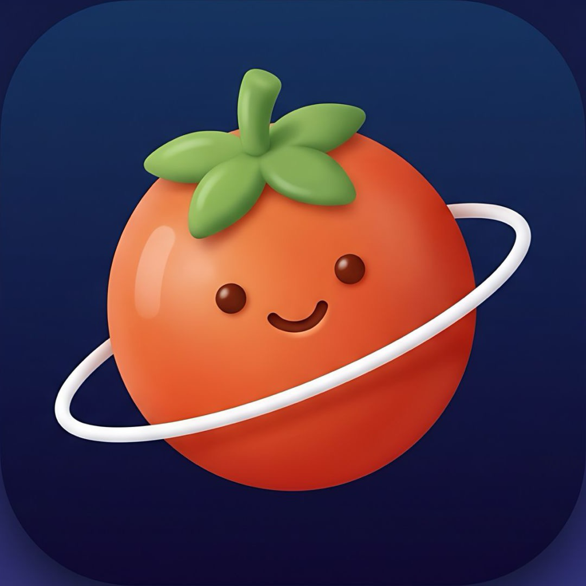

# 番茄小星球 🍅

一个给小学生用的 Mac 番茄钟。单模式计时、完成响铃 20 秒、本地统计。



## 特性

- **一次只跑一个模式**：专注 / 短休息 / 长休息，选哪个跑哪个
- **时长可调**：专注 10/15/20/25，短休息 3/5/10，长休息 10/15/20 分钟
- **圆环倒计时**：番茄星球主题，专注橙色、休息青绿
- **完成提醒**：连续响铃 20 秒 + 应用内横幅 + 窗口自动前置
- **今日统计**：完成番茄数、累计专注时长、中断次数，本地保存并按天重置
- **休眠安全**：倒计时基于绝对时间戳，合盖唤醒后时间正确

## 构建

需要 macOS 13+ 与 Swift 5.9+。

```bash
cd PomodoroStar
swift build
swift test
```

## 打包成 .app

```bash
bash scripts/bundle.sh
open build/PomodoroStar.app
```

## 打包成 .dmg

```bash
bash scripts/bundle.sh          # 先构建 .app
bash scripts/make-dmg.sh 1.0.0  # 再生成 DMG（内含「拖到应用程序」快捷方式）
```

生成的 DMG 位于 `build/PomodoroStar-v1.0.0-macOS-arm64.dmg`。

## 重新生成图标

```bash
bash scripts/make-icon.sh          # 从 icon/icon-1024.png 生成 AppIcon.icns
python3 scripts/make-avatar.py     # 生成圆形头像
```

## 结构

```
Sources/PomodoroStarCore/   纯逻辑，无 UI 依赖，可命令行测试
  Models.swift              阶段与配置
  TimerEngine.swift         计时状态机（绝对时间戳）
  StatsStore.swift          每日统计持久化
Sources/PomodoroStar/       SwiftUI 界面
Tests/PomodoroStarCoreTests/
```

核心逻辑与界面分离，`TimerEngine` 不 import SwiftUI，因此全部行为都能用单元测试验证。

## 测试

24 个单元测试，覆盖：

- 初始状态与时长配置
- 绝对时间扣减、休眠跨越截止时间
- 暂停冻结与恢复
- 放弃只记中断不计完成
- 长休息轮次（含除零保护）
- 统计读写、跨天重置、文件损坏降级、写盘失败告警

## 许可

MIT
